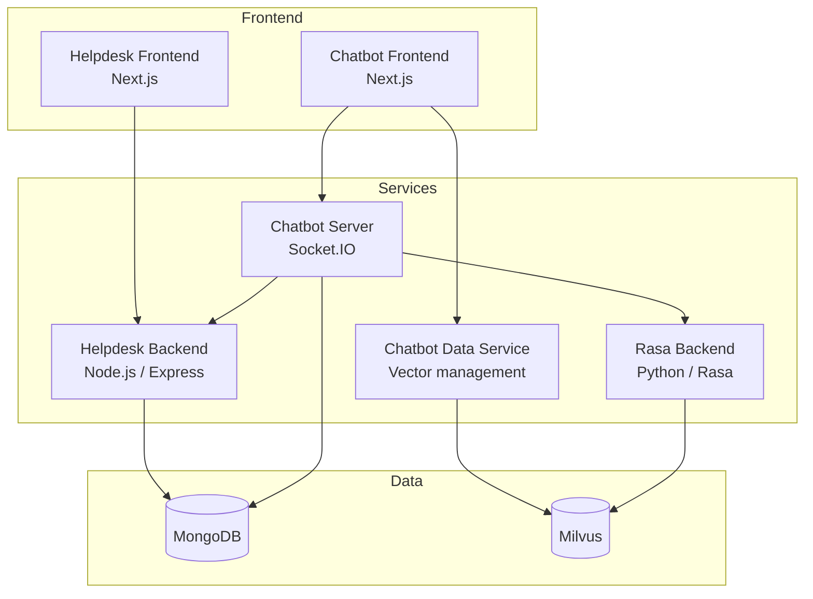

# Automated Helpdesk

A campus support helpdesk with an AI chatbot. Students and staff can raise and track support tickets through a web based chatbot, which answers from a searchable knowledge base and can create a ticket or hand the conversation to a human agent.

I designed and built it on my own as my final-year Computer Science capstone project.

## What it does

**Helpdesk**
- Create, assign, track and resolve tickets through their full lifecycle
- Admin, agent and user roles with role-based permissions
- Live ticket updates over WebSockets
- Email notifications for ticket changes
- A knowledge base with semantic search
- Reporting and metrics for agents and admins

**Chatbot**
- Intent recognition and conversation handling with Rasa
- Retrieval-augmented answers: relevant knowledge base content is found by meaning rather than exact keywords (OpenAI embeddings stored in Milvus), and the reply is generated from it
- Ticket creation and lookup from inside the chat
- Handoff to a human agent, with the conversation passed along

## Architecture



In short: the chat interface talks to the chatbot server over WebSockets. Rasa works out what the user wants. For questions, the relevant knowledge base content is retrieved from Milvus and used to generate the answer. Anything ticket-related goes through the helpdesk backend, which stores its data in MongoDB.

| Service | Port | Stack | Role |
|---|---|---|---|
| Helpdesk Frontend | 3001 | Next.js 14, Tailwind CSS, shadcn/ui | Support dashboard |
| Chatbot Frontend | 3000 | Next.js 14, Socket.IO client | Chat interface |
| Helpdesk Backend | 5500 | Node.js, Express, MongoDB | Business logic and REST API |
| Chatbot Server | 5501 | Node.js, Socket.IO | Real-time chat server |
| Chatbot Data Service | 5502 | Node.js, Milvus | Knowledge base and vector management |
| Rasa Backend | 5005 | Python, Rasa 3.6 | Conversational AI |

## Tech stack

- **Frontend:** Next.js 14, Tailwind CSS, shadcn/ui, React Hook Form, Socket.IO client
- **Backend:** Node.js, Express, Socket.IO, JWT authentication
- **AI:** Rasa 3.6 (Python and YAML), retrieval-augmented generation, OpenAI embeddings, Milvus, LangChain
- **Data:** MongoDB, Milvus
- **Infrastructure:** Docker and Docker Compose

## Getting started

You will need Docker with Docker Compose, and an OpenAI API key. Node.js 18+ and Python 3.8+ are only needed if you run services outside Docker.

```bash
git clone https://github.com/glitchbytez/automated-helpdesk.git
cd automated-helpdesk

cp .env.example .env
# edit .env with your own values

docker compose up -d
```

Then open:

- Helpdesk dashboard: http://localhost:3001
- Chatbot: http://localhost:3000

### Configuration

All services read from a single `.env` file in the project root.

| Variable | Purpose |
|---|---|
| `OPENAI_API_KEY` | Embeddings for knowledge base search |
| `RASA_PRO_LICENSE` | Rasa license key |
| `JWT_SECRET` | Signing key for auth tokens |
| `EMAIL_USER` / `EMAIL_PASSWORD` | Account used to send notification emails |

Seed accounts for each role are created on first start. See [SETUP.md](SETUP.md) for details. Passwords must be changed on first login.

## Development

Run only the infrastructure in Docker and the services locally:

```bash
docker compose up mongodb milvus etcd minio -d

cd helpdesk-backend && npm install && npm run dev
cd helpdesk-frontend && npm install && npm run dev
cd chatbot-data-service && npm install && npm run dev
cd chatbot-server && npm install && npm run dev
cd chatbot-frontend && npm install && npm run dev

cd rasa-backend && pip install -r requirements.txt && rasa run --enable-api
```

Useful commands:

```bash
docker compose logs -f <service>      # follow a service's logs
docker compose restart <service>      # restart one service
curl http://localhost:5500/api/health # helpdesk API health check
curl http://localhost:5502/api/health # vector service health check
```

Backend tests:

```bash
cd helpdesk-backend && npm test
```

## Security

- JWT authentication with role-based authorization
- Input validation and sanitization on API requests
- Rate limiting on the API
- Configured CORS
- Secrets kept in environment variables, never committed

To report a vulnerability, see [SECURITY.md](SECURITY.md).

## Documentation

- [User Manual](USER_MANUAL.md) and [Quick Reference](QUICK_REFERENCE.md)
- [Setup](SETUP.md), [Development](DEVELOPMENT.md) and [Docker Setup](DOCKER_SETUP.md)
- [API reference](helpdesk-backend/docs/technical/api.md)
- [Admin guide](helpdesk-backend/docs/user/admin-guide.md)
- [Architecture notes](helpdesk-frontend/docs/technical/architecture.md)
- [Rasa training guide](rasa-backend/docs/user/training-guide.md)

## Roadmap

- Additional chat channels beyond the web interface, such as WhatsApp, Slack or Microsoft Teams
- Automated test coverage across all services, run on every push in a CI pipeline
- Ticket SLA timers with automatic escalation
- Satisfaction ratings after a ticket is resolved
- Multilingual support in the chatbot and knowledge base
- A production deployment guide covering HTTPS, secrets management and monitoring

## Contributing

Contributions are welcome. Please read [CONTRIBUTING.md](CONTRIBUTING.md) first.

## License

MIT. See [LICENSE](LICENSE).

## Acknowledgments

Built with [Rasa](https://rasa.com), [Milvus](https://milvus.io), [OpenAI](https://openai.com), [Next.js](https://nextjs.org) and [shadcn/ui](https://ui.shadcn.com).
